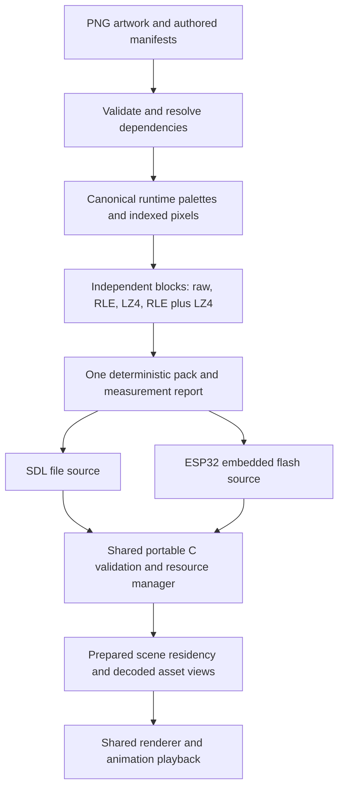

# Summary

Jellipak compiles source artwork into a deterministic, indexed resource pack shared by
desktop and device. Store small palettes, coverage masks, and independently
compressed image blocks. Load only the active presentation's dependencies into
bounded, caller-owned memory. Keep animation playback and drawing free of
storage reads and decompression.

The owner requested a design before implementation, including real measurements,
closer desktop/device runtime alignment, and a worker interface that exercises
native concurrency and ESP32 dual-core execution. This RFC proposes the boundaries
and acceptance gates; it does not approve a wire format, memory budget, codec
dependency, or production migration.

# Current implementation and motivation

The subsequent implementation increment adds a provisional raw/LZ4 block
container reader and native verifier, recorded in
[memo-073](../memos/memo-073-jellipak-block-reader.md). The later
[artwork compiler](../memos/memo-074-jellipak-artwork-compiler.md) adds provisional
binary image/palette metadata and grouped packing with Python fidelity checks.
Neither increment replaces the rendering asset paths below.

[The asset validator](../../tools/assets/build_slice.py) checks source PNGs,
palettes, geometry, and clip references. [The embedded
generator](../../tools/assets/embed_slice.py) emits RGB565 pixels and separate
coverage masks as immutable C arrays, plus creature presentation tables.
[CMake](../../cmake/JelliPetAssets.cmake) generates these arrays for rendered
builds. Firmware can read that artwork from flash; it does not currently
allocate a decoded copy of the entire art collection in PSRAM.

Desktop live reload takes a different route:
[the SDL decoder](../../ports/sdl/asset_pack.c) expands the whole live pack into
one of [two banks](../../ports/sdl/asset_reload.h), and
[the reload adapter](../../ports/sdl/asset_reload.c) validates and swaps them.
[Asset lookup](../../core/asset_source.c) falls back to embedded artwork on a
miss. This makes partial overrides convenient but would hide residency bugs in
a compressed resource manager.

The proposed change should buy measured flash space for additional artwork,
avoid desktop-only decoding behavior, and bound RAM independently of the whole
catalog. It trades direct flash access for an explicit decoded working set.
Reduced disk or payload size alone is not proof of net firmware savings.

This narrows the asset-loading direction in
[RFC-001](rfc-001-virtual-pet-systems-architecture.md#content-authoring-compiler-and-data-loader).
Gameplay definitions and saves remain outside the new image pack initially.
Preserve per-form artwork and authored colors from
[ADR-012](../adr/adr-012-data-driven-creature-species-and-presentation.md).

# Build-to-runtime mapping



| Layer | Proposed responsibility | Existing integration point |
| --- | --- | --- |
| Host build tools | Validate, index, compress, derive dependency lists, report sizes | `build_slice.py`, `embed_slice.py`, `JelliPetAssets.cmake` |
| Portable pack reader | Parse explicit byte fields, validate tables and blocks, decode with capacity checks | Replace the decoding responsibility in `ports/sdl/asset_pack.c` |
| Portable residency manager | Plan, pin, load, commit, and retire bounded resource sets | New core resource module, supplied with host storage and arenas |
| Portable presentation code | Declare resources needed by the next visible view | `core/pet_engine.c`, `core/pet_render.c`, gallery and collection views |
| Host adapter | Provide source bytes, startup memory, and service scheduling | SDL session and ESP32 session |
| Renderer | Read stable native-endian RGB565/mask views already resident | `include/jelli/assets.h`, `core/pet_canvas.c` |

Both platforms must exercise the same parser, codecs, dependency planning,
residency limits, and publication rules. SDL must not retain a separate
permissive loader. A desktop device-budget mode uses the exact configured device
capacities; bigger desktop allocations must not be required to pass acceptance.

# Build process

## Stable authoring, compact runtime representation

Keep PNGs, asset IDs, named palettes, palette ramps, clips, anchors, and bounds
as the authoring interface. The compiler creates a separate runtime
representation without reordering the author's palette or rewriting source art.

For each palette group, convert opaque source colors with the existing RGB565
conversion. A pet's compatible frames share one palette stored with that image
set, rather than repeating it per frame. Background sets and compatible UI images
can share palettes too. Remove colors unused across the group, combine colors
that become identical in RGB565, and sort remaining values deterministically.
Remap every image to those same indices: the same index must mean the same color
throughout a group. Identical palette tables can additionally share storage
across groups. Report source-color collisions so they
are visible without treating an already-identical rendered color as a new loss.
Do not quantize unrelated palettes into one global palette or merge merely
similar colors.

Palette groups and compression blocks are separate levels. A palette group can
span many bounded compression blocks; loading one block does not require
decoding the entire pet. If the union of a proposed group's opaque colors
exceeds sixteen, split it into compatible subgroups. Never discard a color to
force unrelated artwork into a shared palette.

A pet image set is an artwork resource group, not an individual saved pet.
Multiple pets using the same form share its resources. The experiment groups
palettes per form; compatible evolution forms may share a palette in the
eventual compiler without requiring both forms to be resident. Cross-form
palette grouping has not yet been measured.

Use four-bit indices and a separate one-bit coverage plane initially. Sixteen
opaque colors plus transparency require seventeen states; reserving an index
for alpha would silently remove an allowed color. Define row padding and nibble
order explicitly, zero unused padding, and normalize indices under transparent
pixels. Font bitmaps retain their existing bit-plane representation.

Verify every opaque reconstructed RGB565 pixel and every coverage bit against
the current exporter. Transparent RGB values may normalize because they are
not drawn. Anchors, bounds, frame ordering, and animation timing must remain
unchanged. Smaller index widths and cropped storage are later opportunities,
not prerequisites for this migration.

## Compression units and usable groups

Separate the **palette group**, **physical decode block**, and **logical
residency group**. Palette groups preserve consistent color symbols. Compression
blocks hold one or more image payloads; directory entries retain each image's
offset and length within its block. Dependency lists collect the assets needed
for a form, location, or view.

Arrange frames by pet/form and clip usage, place related backgrounds together,
and group compatible UI art by palette and usage. Adjacency alone improves read
locality, not compression: related image bytes must share a compression block
to expose cross-image repetition to LZ4. Use shared palette indices to keep that
repetition meaningful rather than assigning a different color to each frame's
index zero.

| Logical group | Residency rule |
| --- | --- |
| Common UI and font | Small always-resident set with an explicit budget |
| Active pet form | Unique frames across its reachable clips, including fallback poses |
| Active location | Its background and visible scene dependencies |
| Activity, props, effects, rewards | Dependencies for reachable visible overlays or an explicit transition |
| Collection/gallery page | Visible portraits/thumbnails and selection details, even when they belong to inactive pets |

Group membership comes from resolved content and presentation references, not
filename guessing at runtime. Reused frames point at one asset/block record.
Do not pull every form in an evolution family into RAM just because one form is
active. Cross-pet interactions must request all visible participants.

Measure independent image blocks as the baseline and bounded multi-image blocks
as the intended packing optimization. A batch of backgrounds can compress
together even though only one scene is resident. On a miss, decode that block
into indexed scratch, then expand only requested images into resident RGB565
storage. Unused neighbors consume decode work, not permanent scene residency.
Process all currently requested images from a block before releasing its scratch,
so a scene request does not decode the same block once per image.

Compare candidate decoded-block ceilings such as 8, 16, and 32 KiB against
payload savings, block count, load latency, and maximum bytes decoded for a
single-image miss. A palette or semantic group may span multiple independently
decodable blocks. Avoid grouping unrelated pets merely to improve a global
ratio. If an individual image exceeds the selected ceiling, divide it at row
boundaries into explicitly indexed strips or reject it with a capacity error.
Avoid animation delta chains and cross-block dictionaries in the first format:
seeking an image must not require decoding predecessors.

For each block, measure raw indexed bytes, RLE, LZ4, and RLE followed by LZ4.
Choose the smallest allowed representation with deterministic tie breaking and
raw fallback. RLE must have literal runs so noisy data cannot grow without a
known bound. Keep the set of shipping codecs smaller if firmware code size
outweighs a codec's measured payload saving.

The [initial experiment](../memos/memo-070-compressed-resource-payload-measurements.md)
finds only 43 bytes of extra payload saving from allowing the RLE candidates
alongside LZ4 when encoding images independently in the current catalog.
The multi-image grouping experiment measures raw/LZ4, so repeat the RLE
comparison on the selected grouped layout before finalizing the codec subset.
Recommend raw/LZ4 for the first runtime
prototype while retaining RLE in the build experiment. The owner's requested
RLE approach is therefore evaluated explicitly rather than assumed to help
every image or forced into every block.

LZ4 is the initial fast block-compression candidate. Its
[block specification](https://github.com/lz4/lz4/blob/dev/doc/lz4_Block_format.md)
requires the containing format to supply size information. Use independent
blocks and a bounded decoder, with no borrowed history. If RLE is wrapped in
LZ4, record both the intermediate RLE length and final indexed length; the
intermediate scratch requirement belongs in the budget. Pin and license-review
the chosen implementation before integration. Host throughput is not ESP32
decode-time evidence.

## Incremental and reproducible outputs

Produce `resources.jellipak`, generated stable-ID/dependency metadata, and a
machine-readable size report from one compiler invocation. Both targets consume
the same logical bytes. ESP32 embeds the pack once as flash data; SDL reads those
bytes from a file or memory fixture. Stop linking the full old RGB565 arrays when
the compressed path becomes the default. Split the current generator's outputs
so IDs, creature clips, and presentation tables remain available without
accidentally retaining the old pixel arrays.

Make declared dependencies include PNGs, manifests, referenced content, compiler
modules, format schema, codec settings, and tool pins. Write outputs atomically
and only replace files whose contents changed. Exclude timestamps, absolute
paths, and directory enumeration order from generated bytes.

An optional block cache is keyed by normalized pixels, palette, format version,
and codec/tool versions. A warm build, cold build, and cache-disabled build must
produce identical outputs. Changing one frame should regenerate its affected
blocks and dependent metadata, not recompress unrelated content.

# Portable pack and resource APIs

## Pack contents

Proposed tables, not a finalized binary layout:

| Section | Information |
| --- | --- |
| Header | Magic, version, total length, table counts/offsets, catalog compatibility hash, integrity metadata |
| Asset directory | Stable ID, kind, geometry, palette-group ID, ordered block references and decoded subranges |
| Palette table | Canonical RGB565 values and bounded palette lengths |
| Block directory | Offset, stored length, codec, intermediate length, decoded length, checksum |
| Dependency table | Bounded group-to-asset references for forms, scenes, and views |
| Payload | Independently encoded blocks |

Illustrative layout, with lengths and capacities determined by the compiler:

```text
pet/form palette P
  image directory: idle-a -> block A, offset/length
                   idle-b -> block A, offset/length
                   eating -> block B, offset/length
  block A: related indexed frames and masks, compressed together
  block B: further frames using the same palette P

background palette Q
  image directory: home -> block C, offset/length
                   garden -> block C, offset/length
  block C: compatible backgrounds compressed together
```

Directory references share palettes without duplicating their bytes inside
every block. Validate decoded image subranges as well as stored block ranges.
Logical grouping does not require a native filesystem directory or opening one
file per pet: all groups live in the single indexed Jellipak artifact.

Use explicitly decoded little-endian fields, never serialized native structs
or casts of unaligned bytes. Validate counts, offsets, multiplication, overlap
rules, references, codec IDs, exact decoded lengths, and integrity before making
data visible. CRC detects corruption, not authenticity.

Validate metadata at mount and payload integrity before admitting each block.
The compiler and CI perform a full decode sweep; mounting need not eagerly
decode every image. Unknown versions, unsupported capabilities, missing required
assets, and capacity exhaustion return distinct bounded errors.

The pack compatibility hash covers compiled asset IDs, geometry and presentation
contracts. Initially hot reload can replace compatible artwork; clip, behavior,
or catalog changes still require a rebuild. Do not accidentally promise dynamic
gameplay definitions through an image format.

## Ownership and proposed operations

The portable manager receives a source size, a bounded `read_at` callback,
caller-owned metadata storage, a scratch area, and fixed residency arenas.
No SDL, filesystem, ESP-IDF, PSRAM, or task types enter its public C interface.
A memory source adapter is shared by firmware and host tests; SDL's file
adapter owns its file handle and reports short reads explicitly.

Conceptual operations are `mount`, `plan`, `service`, `ready`, `commit`, and
`lookup`; names and signatures remain implementation work. `plan` consumes a
bounded list of required asset IDs, closes dependencies, checks the capacity
before starting, and returns an immutable request generation.
`service` executes a bounded number of blocks/bytes per call outside drawing.
`commit` publishes a complete generation at a frame boundary.

Distinguish the stored compressed length, indexed block output length, optional
RLE intermediate length, and expanded RGB565/mask residency length. Reserve
scratch for the intermediate representations and destination storage for the
expanded images; compressed byte counts are not residency capacities.

Keep metadata available even when pixels are absent: layout, scaling, and
anchor lookup must not trigger decode. Preserve `JelliAsset`-style decoded
views initially to minimize renderer changes. Palette expansion happens once
on residency admission, not for every sprite pixel in every frame.

Pointers to decoded pixels remain valid throughout the frame and through the
host's synchronous `present` read/copy contract. No active block can be evicted
while pinned by that generation. On commit, invalidate render keys and actor
frame caches explicitly, even if the manager reuses the same view address.
Longer-lived caches retain asset IDs plus generation checks, not stale pointers.

Compressed mode has no silent fallback to the entire old embedded catalog.
Keep only a deliberately small recovery font/marker independent of the pack.
A missing required resource is a planning or validation error, not an invisible
substitution that would let desktop tests pass.

# Frame-loop and scene-transition behavior

[The current frame function](../../core/pet_engine.c) updates state, consumes
input, updates the gallery, renders, and presents synchronously. Introduce a
resource preparation boundary shared by both hosts:

1. Advance authoritative simulation and input; derive the desired visible view
   and its resource request in portable presentation code.
2. Retain the current committed presentation while the host services the next
   request between render calls. Rendering never calls `read_at` or decoders.
3. Decode and validate only missing blocks into staging capacity. Shared pinned
   resources stay resident.
4. If the desired view changes again, cancel or supersede the stale request
   without publishing it. Associate requests with a generation.
5. Once ready, atomically publish the prepared view and its resource generation,
   invalidate damage caches, then render and present.
6. Retire old-only blocks after the frame no longer references them.

Keep simulation time independent of loading progress. While loading, retain the
last complete framebuffer or render a bounded loading view; do not render new
pet state using old pet pixels. Gate presentation-specific input against the
committed view so taps cannot accidentally operate the not-yet-visible scene.
Failures retain the committed view and report a retryable error. Cold-start
failures use the minimal built-in recovery view.

Execute resource service through the worker interface below. A deterministic
inline executor provides a reference and constrained-host fallback; desktop and
ESP32 also exercise real asynchronous executors. The worker algorithm and
request/completion rules are identical in all modes. A service step has a
byte/block work limit; its actual worst-case latency must be measured.

Desktop reload mounts an immutable candidate source, validates it with the same
code, prepares the current view's working set, and swaps only when ready.
Keep the previous source and generation alive until their users retire. The
file adapter must avoid reading a mixture of revisions while authoring replaces
the file. No full-pack double decode is required for transactional reload.

# Worker interface and dual-core execution

Introduce a narrow host execution wrapper, rather than exposing FreeRTOS or a
desktop thread library to the game or Jellipak format. The portable resource
worker accepts an immutable load plan and fills reserved output spans using
its private decoder context. The engine thread owns all game/UI state, planning,
slot reservation, render publication, and retirement.

| Component | Ownership and execution |
| --- | --- |
| Engine/render thread | Creates requests, pins existing assets, reserves destinations, consumes completion, commits views |
| Resource worker | Reads a retained source, decodes into private scratch, expands requested images into exclusive staging spans |
| Host executor | Starts/stops worker, provides bounded submission/completion transport and synchronization |
| Inline test executor | Runs the same worker steps under an explicitly controlled schedule |
| Native threaded executor | Uses OS threads through the wrapper; exercises concurrent completion and shutdown |
| ESP32 executor | Uses a FreeRTOS worker task; affinity and priority follow measured contention |

Conceptual wrapper operations are `start`, `try_submit`, `poll_completion`,
`request_cancel`, and `stop_and_join`. This is not a general-purpose job system.
Start with one job in flight, one pending desired view owned by the engine,
and one completion slot. Request storage, worker stack, queues, and scratch
are fixed at startup. A busy submission returns a distinct status; the engine
coalesces its pending desired view instead of growing a queue or blocking input.

Each job carries both a source generation and a requested-view generation,
retained source handle, immutable block plan, destination spans, and decode
limits. It does not borrow mutable game state or stack-local descriptors.
The worker must not render, call display/LVGL APIs, modify residency maps,
publish assets, allocate per frame, or mutate the active catalog. Completion
returns the two identities and success/error status. Only the engine decides
whether the result still matches the desired source and view.

Submission makes job inputs visible to the worker. Completion publication
makes all output writes visible to the engine. Require these happens-before
guarantees in the wrapper and implement them using host synchronization
primitives; `volatile` is not synchronization. No renderer reads staging
before completion and commit. Keep platform mutexes and atomic representations
out of the portable public interface.

Cancellation is cooperative at block/read-step boundaries. Requesting cancel
does not free the source, overwrite the job, or reclaim destination spans.
The worker must acknowledge completion or cancellation before those resources
are reused. Discard a stale successful result without publishing it. Retain
completion until consumed: silently dropping it on a full queue could leak
ownership or allow early reuse. Measure cancellation delay as well as decode
latency; a bounded byte count is not a hard storage-read deadline.

```text
engine: reserve -> submit --------------------------------> consume -> commit
worker:             read -> decode -> expand -> seal completion
render: draw committed resources throughout; never read pending output
cancel: request --------> worker acknowledges --------> reclaim stale staging
```

Shutdown stops new jobs, requests cancellation, joins the worker, then closes
sources and releases storage. A worker must not need a render lock held by its
joining thread. Failed jobs and failed commits use the same retirement rules.
Source adapters declare their threading contract: give a file-backed job an
immutable handle without concurrent seek/close, or synchronize reads explicitly.
Reload retains the prior source until its jobs and generations retire.

Native desktop must exercise the exact worker body through a real thread,
alongside deterministic schedule tests. CMake thread discovery helps link
support but is not a runtime threading abstraction. Provide explicit native
adapters for supported operating systems; preserve the inline executor for
core-only builds. Windows validation must exercise its worker adapter, not rely
solely on existing core-only compilation.

ESP32's second core is not assumed idle. The current
[application loop](../../ports/esp32/main/main.c) runs the engine in `app_main`;
[network](../../ports/esp32/main/network.c) and
[audio](../../ports/esp32/main/sound_output.c) create separate tasks.
The display adapter also uses SDK/BSP execution. Inspect the resolved
configuration and runtime task list before assigning the worker. Benchmark
unpinned and suitable pinned placements with priorities that preserve input and
display responsiveness. Dual-core execution can overlap rendering and loading
while still contending for flash cache, PSRAM, and memory bandwidth. Do not move
framebuffer or LVGL ownership as part of this change.

Acceptance includes inline/threaded output equivalence, delayed completion
after superseding requests, cancellation at each service boundary, rapid
pet/scene switching, reload during loading, full queues, short reads, failed
workers/commits, and shutdown with a job active. Use native ThreadSanitizer
where supported and repeated real-thread stress runs. Deterministic scheduling
hooks reproduce races; they do not replace concurrent testing.

Measure load latency, render/input frame-time tails, worker CPU time, and stack
high-water marks on ESP32. Faster scene loading with worse visible frame stalls
does not pass. Keep desktop correctness, firmware build, hardware timing, and
physical interaction evidence separate.

# Resource budgets and viability

Account separately for flash payload, directory/palette bytes, codec text,
static internal RAM, PSRAM, scratch, task stacks, and existing framebuffers.
Compression does not reduce the framebuffer allocations described in
[the host contracts](../../docs/development.md#boundary-between-engine-and-host).

For the initial expanded residency design:

```text
steady residency = common + current form + location + visible extras
transition peak  = current residency + next-only decoded assets + scratch
resource RAM     = transition peak + metadata + slot bookkeeping + worker overhead
flash delta      = old linked image - new linked image
```

Worker overhead includes its stack, request/completion records, synchronization
objects, and source read buffers. Decoder scratch already appears in transition
peak and must not be counted twice. It must cover indexed-block output and
compressed input that coexist, plus any RLE intermediate. Expanded RGB565
destination bytes are a separate allocation from that scratch.

Count shared blocks once. Reserve all destination storage before replacing
anything. A fixed-slot or fixed-arena layout must bound fragmentation as well
as total bytes; this is not permission to add a general heap to the core.
If the peak cannot fit, use an explicit recovery/loading-view transition that
releases old scene resources first. Do not silently evict still-visible assets.

An initial inventory at source revision `d830df7` on 2026-10-19 measured:

| Artwork payload | Current RGB565 plus masks | Four-bit indices plus masks |
| --- | ---: | ---: |
| All art, including font | 333,672 B | 98,952 B |
| Creature frames | 171,904 B | 50,560 B |
| Backgrounds | 52,224 B | 15,360 B |

These counts sum the validated dimensions using the existing font payload and
row-padded planes. The indexed column excludes palettes, directories, alignment,
and codec code; it is an intermediate representation, not a measured firmware
size. RGB565 decoded frame sets for the current clip groups range from 17,408 B
for baby/grown to 88,128 B for axolotl. One current background costs 8,704 B
decoded. These dated observations motivate a working set; they do not establish
that transition peaks fit the device.

[Memo-070](../memos/memo-070-compressed-resource-payload-measurements.md) records
actual encoded payload measurements and the reproducible experiment. Independent
LZ4 blocks plus deduplicated palettes total 33,494 bytes on this catalog,
compared with the 333,672-byte baseline. The difference is 300,178 bytes before
directory/alignment costs and linked decoder overhead. This is promising
payload evidence, not a claim of that much additional firmware partition space.

The grouped experiment further reduces payload plus shared palettes to
20,444 bytes with a 16 KiB indexed-block ceiling, or 19,275 bytes with a
32 KiB ceiling. The larger ceiling saves another 1,169 bytes but increases the
largest measured decode chunk from 16,200 to 30,920 bytes. Treat 16 KiB as a
candidate for the prototype, not an approved capacity: measure device latency
and total scratch before selecting it. The report records single-image
overfetch, ordering alternatives, and all excluded metadata costs.

Final capacity constants require the report's worst-case view closure and
old/new transition union, plus firmware memory measurements. Enumerate gallery
pages, form evolution, pet switching, location changes, activity overlays, and
cross-pet scenes. Checking only an idle pet would miss the real maximum.

# Measurement and acceptance

Record compression experiments as reproducible evidence alongside this RFC.
Distinguish four quantities: normalized image payload, complete serialized pack,
linked firmware image, and usable free partition space. Only the last two
establish how much additional artwork can actually ship.

For every candidate, record source SHA and dirty state, source/pack hashes,
Python and codec versions, command line, profile/configuration, build mode,
payload by asset kind, palettes, directory bytes, padding, and per-codec totals.
Compression ratios must use the same catalog and semantics on both sides.
Show which codec wins by type and how much removing each codec would cost.

The implementation acceptance report must include:

| Evidence | Required comparison |
| --- | --- |
| Build determinism | Two clean builds and one warm build have identical pack hashes; one-image edit rebuilds only affected inputs |
| Pixel fidelity | Decode every block; compare coverage, opaque RGB565 pixels, geometry, and clip references |
| Pack saving | Actual file lengths including all tables, palettes, padding, and integrity fields |
| Firmware saving | Matched old/new release builds with identical art and SDK/config; application binary and linker-map attribution include codec code and remove old arrays |
| Content headroom | Net application bytes saved, free app partition bytes, and marginal cost of representative additional pet/background groups |
| Runtime memory | Peak internal RAM, PSRAM, scratch, metadata and task-stack usage, including transitions |
| Runtime work | Desktop and device cold scene load, pet switch, location switch, worst block decode, and warm animation; report distributions and maxima |
| Shared-code coverage | Same bytes and requests through memory and file sources, under device limits, with identical decode results and error behavior |

Do not set a claimed percentage gain before collecting the complete-pack and
firmware comparisons. A codec whose linked cost exceeds its payload saving is
not a flash optimization for this catalog. Likewise, a smaller pack with an
unacceptable scene-load latency or RAM peak does not pass.

Host tests should include truncated and corrupt tables, invalid indices,
overflowing lengths, unknown codecs, RLE expansion limits, short reads, failed
loads, full pools, cancellation, eviction/pinning, and generation invalidation.
Use the project sanitizer and fuzz/property-test malformed decoding.
An instrumented source must prove that warm animation frames perform zero
resource reads and zero decompressions. Snapshot comparisons cover active pets,
backgrounds, gallery pages, overlays, and reload rollback.

Host validation does not establish physical timing or behavior. Firmware build,
device latency/heap measurements, and physical display/touch evidence remain
separate. This design work does not request flashing hardware.

# Staged implementation

[RFC-009](rfc-009-bounded-memory-systems-and-adoption.md) defines the prerequisite
memory contracts and edge tests.
[RFC-010](rfc-010-jellipak-build-and-validation.md) specifies the proposed
feature, self-test, and build-validation contracts. Neither companion turns
the production stages below into implemented functionality.

1. **Measurement prototype:** compare representations on current artwork,
   verify lossless round trips, and record payload gains and costs. Select
   codec candidates and block granularity from evidence.
2. **Pack contract and shared C reader:** version the minimal format, implement
   bounded decoding and memory/file adapters, and run full-catalog/malformed
   input tests. Keep the existing renderer as the comparison oracle.
3. **Shared residency, worker, and presentation boundary:** add explicit requests,
   generation ownership, transition staging, and device-capacity tests to
   desktop. Implement deterministic and native threaded executors with
   cancellation/shutdown tests. Integrate lookup and metadata without fallback
   hiding misses.
4. **Build and firmware integration:** embed the same pack, remove duplicate
   raw arrays, add the FreeRTOS executor, compile relevant firmware profiles,
   and measure net flash and peak memory against the matched baseline.
5. **Reload and hardware acceptance:** route Studio output through the common
   compiler and candidate-load path, validate rendering parity, then measure
   device transitions and animation under authorized hardware testing.

Each stage has its own review and evidence. The draft does not authorize all
stages automatically. Keep the old path temporarily selectable for comparisons;
the production target must not link both catalogs when reporting savings.

# Tradeoffs and remaining decisions

Fully indexed rendering could reduce decoded RAM further, but changes every
sprite draw and moves palette work into the hot path. Begin with RGB565 views
unless transition memory measurements show they are not viable. Whole-pack
compression is simpler but forces unrelated content into decode work. Large
per-species blocks may improve compression but make portraits and single-form
loads expensive. Animation deltas add seek dependencies and are deferred.

Resolve the final wire layout, codec subset, block ceiling, memory capacities,
source-read service limit, and acceptable measured load latency before accepting
the runtime design. Keep the format extensible through explicit versions and
capabilities rather than shipping speculative codecs or storage backends.
